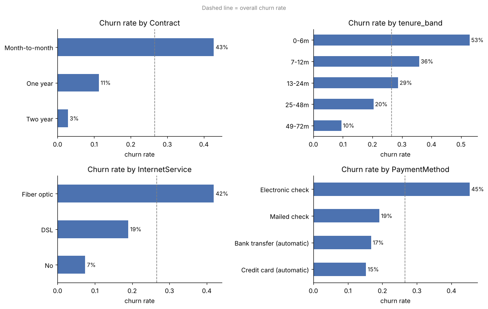
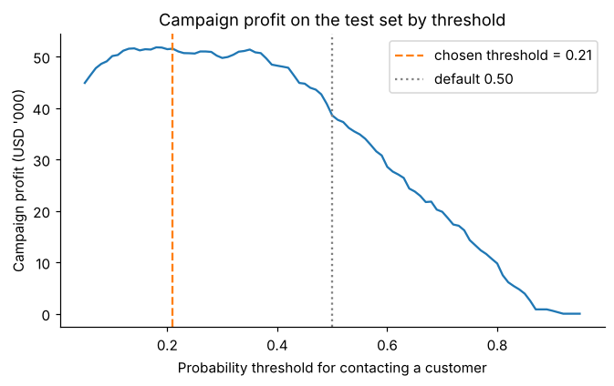
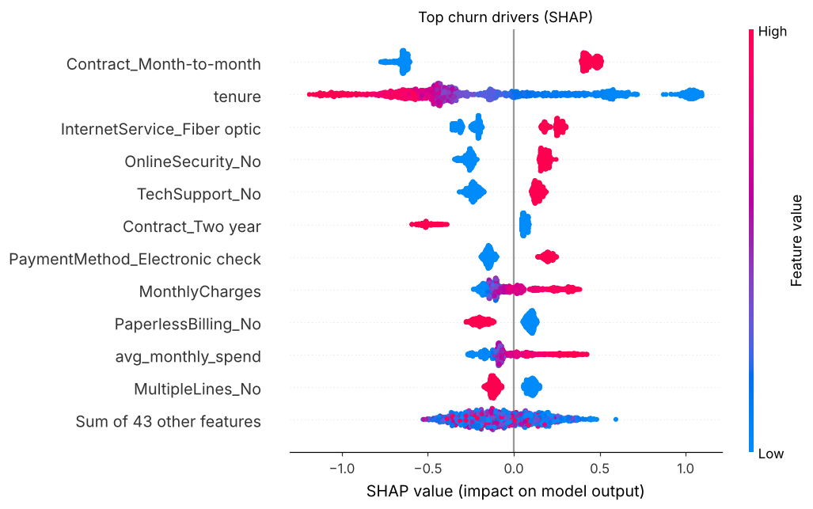

# Customer Churn Prediction and Retention Targeting

**Which customers are about to leave, and who should the retention team call first?**

I built a churn model that ranks customers by risk, then chose the targeting threshold that maximises the profit of a retention campaign instead of using the default 0.5 cut-off. On a held-out test set, the model-driven campaign earns **87% more profit than contacting everyone** and **34% more than the default threshold**.



## Results

| Metric (held-out test set, 1,409 customers) | Logistic regression | XGBoost (tuned) |
|---|---|---|
| ROC-AUC | 0.845 | **0.847** |
| PR-AUC (churn base rate 26.5%) | 0.651 | **0.666** |

- **Ranking quality:** contacting the riskiest 20% of customers reaches **50% of all churners**; the riskiest 30% reaches **67%**. The top decile has **2.8x** the average churn rate.
- **Campaign profit** (assumptions: $50 offer, 30% of contacted churners saved, 12 months of value per saved customer):

| Strategy | Customers contacted | Churners reached | Profit (USD) |
|---|---|---|---|
| Contact everyone | 1,409 | 374 | 27,524 |
| Model, default threshold 0.50 | 288 | 190 | 38,545 |
| **Model, profit-optimal threshold 0.21** | **649** | **314** | **51,516** |

The threshold was chosen with out-of-fold predictions on the training set, so the test-set profit is an honest estimate.



## What drives churn



- **Contract:** month-to-month customers churn at 43%, two-year customers at 3%.
- **Tenure:** 53% of customers in their first 6 months churn, against 10% after 4 years.
- **Service:** fiber-optic customers churn at 42%, and customers without online security or tech support are at higher risk.
- **Payment:** electronic-check payers churn at 45%.

**Recommendations:** offer incentives to move month-to-month customers onto annual contracts, invest in first-6-months onboarding, bundle security and tech support, and review fiber pricing. Before scaling, A/B test the retention offer to measure the real save rate.

## Approach

1. **Data cleaning:** the 11 blank `TotalCharges` values all belong to brand-new customers (tenure 0), so they are set to 0, a domain fix rather than blind imputation.
2. **Feature engineering:** number of add-on services, average historical spend, price-increase ratio (current vs. average charge) and tenure bands.
3. **Modeling:** a scikit-learn `Pipeline` with `ColumnTransformer`, comparing a dummy baseline, logistic regression, random forest and XGBoost with 5-fold stratified CV, then tuning XGBoost with `RandomizedSearchCV` on PR-AUC.
4. **Evaluation:** ROC-AUC, PR-AUC, lift table and cumulative gains on a 20% held-out test set.
5. **Decision layer:** a profit curve converts probabilities into a call list ([`src/churn/business.py`](src/churn/business.py)).
6. **Explainability:** SHAP values for global and per-customer explanations.

## Project structure

```
├── data/raw/telco_churn.csv        # IBM Telco Customer Churn sample
├── notebooks/01_churn_analysis.ipynb  # full analysis with outputs
├── src/churn/
│   ├── features.py                 # cleaning + feature engineering + preprocessing
│   ├── business.py                 # profit curve, lift table
│   └── train.py                    # trains and saves the final model
├── reports/figures/                # charts used in this README
├── tests/                          # pytest unit tests
└── requirements.txt
```

## Data

[IBM Telco Customer Churn sample dataset](https://github.com/IBM/telco-customer-churn-on-icp4d) with 7,043 customers and 21 attributes (demographics, services, contract, billing, churn label).
